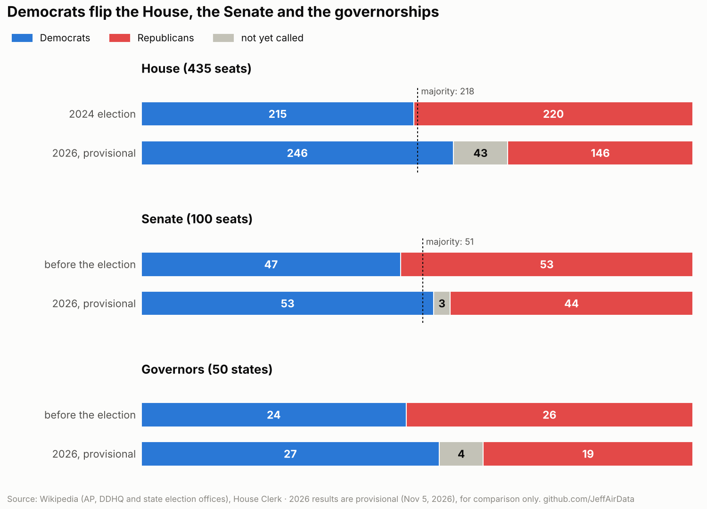
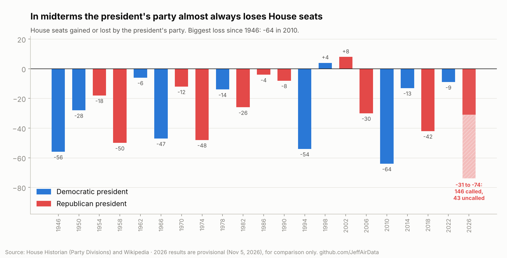
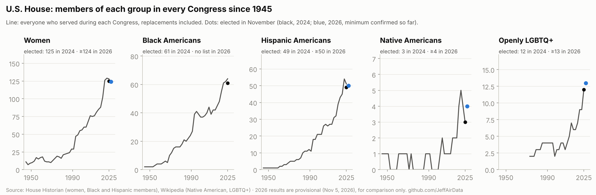

# U.S. elections: Congress and governors, 2024 vs 2026

The November 3, 2026 midterms compared with the 2024 election and with the historical series: House, Senate and governors, always Democrats (blue) against Republicans (red), and the representation of women, Black, Hispanic, Native American and LGBTQ+ members of the House.

👉 **[Open the page](https://jeffairdata.github.io/usa-congress-elections-2024-2026/)**: pick a state and see every district, 2024 vs 2026.

🇧🇷 **Português:** [jeffairdata.github.io/usa-congress-elections-2024-2026/pt/](https://jeffairdata.github.io/usa-congress-elections-2024-2026/pt/). The button at the top of each page switches language.

> **Provisional results.**¹ A snapshot from November 5, 2026. 43 House seats, 3 Senate seats and 4 governorships are still uncalled. The 2026 numbers are for comparison and are not final. To refresh them, run `./run_all.sh --download`.

## The four comparisons

| | Comparison | Charts |
|---|---|---|
| 1 | House, Senate and governors, before and after | `01_nacional.png` |
| 2 | State by state: seats that changed party | `02_estados.png` |
| 3 | Historical series: the president's party in every midterm since 1946, and the House since 1913 | `03_midterms.png`, `04_camara_historico.png` |
| 4 | Women, Black, Hispanic, Native American and LGBTQ+ members of the House, by Congress, and 2024 vs 2026² | `05_diversidade_serie.png`, `06_grupos_2024_2026.png`, `07_mulheres_partido.png` |

English charts are in `docs/img/`, Portuguese charts in `docs/pt/img/`.





## How to read the numbers

- **Fixed colours:** blue for Democrats, red for Republicans, grey for other parties and uncalled races. The two independent senators (Sanders and King) caucus with Democrats and count in the Democratic total.
- **A race is called** when the source marks a winner. Nothing is estimated.
- **2024 matches the official result:** the parser reads 220 Republicans and 215 Democrats, as in the House Historian's *Party Divisions* table.
- **Redrawn maps:** several states changed their districts in 2025 and 2026, so the comparison is by each state's delegation and by the party that won each seat (a "gain" when the seat changes party), not district against district.
- **Group series:** the line counts everyone who served during each Congress, replacements included; the dots count only members elected in November, by the same rule in both years.
- **Women in 2026:** the Clerk's courtesy title (Mr./Ms.) for current members; for first-time winners, the pronouns in each one's Wikipedia article. 11 winners with no article are left out. Nothing is inferred from first names.
- **First-time winners of the other groups** count only when a source names them: Wikipedia's lists of members-elect for Hispanic and Native American members, and the press for LGBTQ+ and Black members.³ 2026 is a minimum, not a total. For Black members there is no list of first-time winners yet.
- **First-time** means not in the current House; a few, such as Elaine Luria, served before.
- **LGBTQ+** counts members who were out while serving; those who came out later or were identified posthumously are left out.

## Sources

| Data | Source |
|---|---|
| 2024 and 2026 results by district; 2026 Senate and governors | Wikipedia election articles (citing AP, Decision Desk HQ and state election offices), raw wikitext stored in `Data/raw/` |
| House seats by party in every Congress since 1913 | [House Historian, Party Divisions](https://history.house.gov/Institution/Party-Divisions/Party-Divisions/) |
| Women, Black and Hispanic members by Congress | House Historian: [women](https://history.house.gov/Exhibitions-and-Publications/WIC/Historical-Data/Women-Representatives-and-Senators-by-Congress/), [Black Americans](https://history.house.gov/Exhibitions-and-Publications/BAIC/Historical-Data/Black-American-Representatives-and-Senators-by-Congress/), [Hispanic Americans](https://history.house.gov/Exhibitions-and-Publications/HAIC/Historical-Data/Hispanic-American-Representatives,-Senators,-Delegates,-and-Resident-Commissioners-by-Congress/) |
| Native American and LGBTQ+ members | Wikipedia: *List of Native Americans in the United States Congress*, *List of LGBTQ members of the United States Congress* |
| Current members and courtesy titles | [House Clerk, MemberData.xml](https://clerk.house.gov/xml/lists/MemberData.xml) |
| First-time LGBTQ+ and Black winners in 2026 | Washington Blade, Advocate, GLAAD, Fast Company and ABC News (Nov. 4–5, 2026) |

Once AP and the states finish counting, the final source will be the House Clerk (*Statistics of the Congressional Election*), and the official diversity counts will come from CAWP (women), CRS and Pew.

---

## For those who want the data

In `Data/processed/`:

| File | Contents |
|---|---|
| `house_districts_2024.csv`, `house_districts_2026.csv` | one district per row: previous members, winner, party, whether called, label (gain or hold) |
| `house_states_2024_2026.csv` | one row per state: D and R seats in 2024 and 2026, uncalled |
| `senate_races_2026.csv`, `governor_races_2026.csv` | the 35 Senate races and the 36 governor races |
| `house_party_divisions.csv` | House seats by party at the start of every Congress since 1913 |
| `midterm_president_party_change.csv` | seats gained or lost by the president's party in every midterm since 1946 |
| `members_by_group_and_congress.csv` | every woman, Black and Hispanic member in every Congress (House Historian) |
| `house_group_series.csv` | count by group and Congress, all five groups |
| `group_members_119_status_2026.csv` | what happened in 2026 to each member of these groups in the current House |
| `house_winners_2026_gender.csv` | gender of each 2026 winner and how it was obtained |
| `house_groups_2024_2026.csv` | 2024 vs 2026 summary by group |
| `summary_2026.json` | the numbers in the text |

To rebuild everything:

```bash
pip install -r requirements.txt
./run_all.sh --download
```

---

<sub>¹ The source of the 2026 results is Wikipedia, which cites AP, Decision Desk HQ and state election offices; the Nov. 5, 2026 revision is stored in `Data/raw/`. AP blocks automated reading. For 2024 the same method reproduces the official result exactly (220 vs 215). In the seats already called, the House numbers are slightly ahead of AP's tally of Nov. 5, 2026 at 9:10 a.m. Brasília time (240 D vs 147 R).</sub>

<sub>² The 2026 diversity numbers are minimums, not totals: a first-time winner counts only when a source names them. Gender of first-time winners comes from the pronouns in their Wikipedia articles; 11 winners with no article are left out. Nothing is inferred from first names.</sub>

<sub>³ Found only in the press, still to be checked: the four first-time LGBTQ+ winners (Washington Blade, Advocate, GLAAD) and Melat Kiros as Colorado's first Black congresswoman (Fast Company, ABC News). Sources also disagree on Denise Powell (Nebraska): the press calls her the state's first Hispanic member of Congress, but Wikipedia's list of Hispanic winners does not include her, so she is not counted.</sub>
